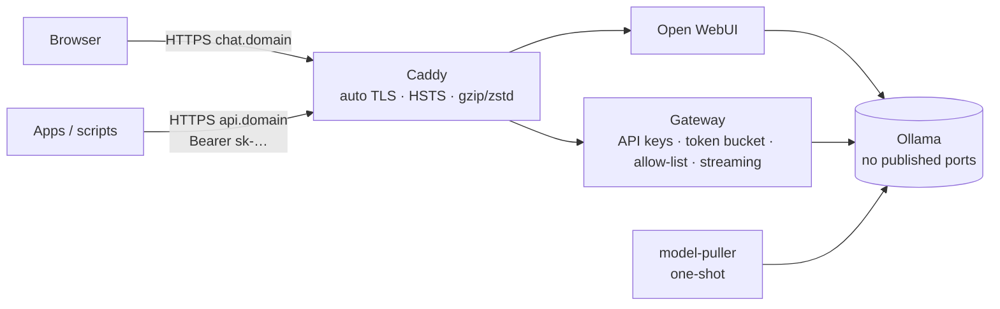
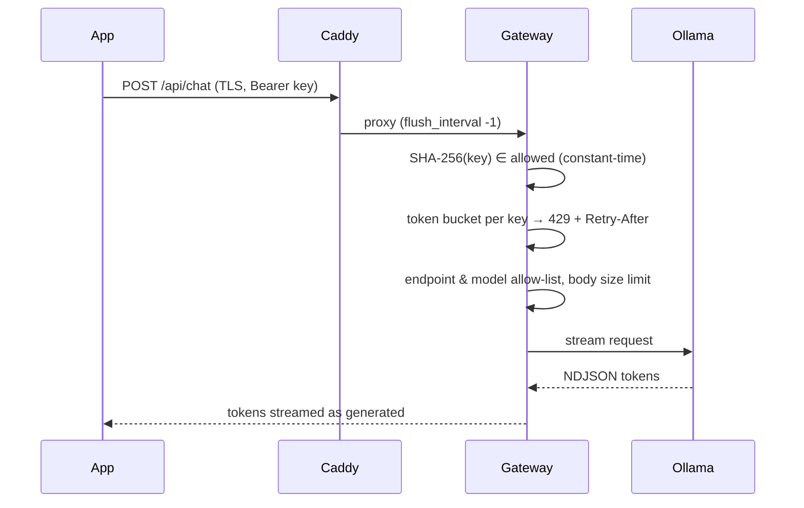

# self-hosted-ai-stack

[](https://github.com/HOFFMAN-ALTERNATIVE/self-hosted-ai-stack/actions/workflows/ci.yml)


A private ChatGPT-style stack on a plain CPU-only VPS: no GPU, no cloud API bills, no prompts leaving the server.

Ollama · Open WebUI · a FastAPI API gateway (API keys, rate limiting, streaming proxy, model allow-list) · Caddy with automatic HTTPS.

## Why

Ollama's API has no authentication, and exposing it directly is a common and costly mistake. This stack keeps Ollama on a private network and puts a small, tested gateway in front of it, so apps can call local models over HTTPS like a hosted API (native Ollama and OpenAI-compatible endpoints) while people get a chat UI.

CI boots the real stack on a CPU-only runner, pulls a real model and streams completions through Caddy TLS, the gateway and Ollama on every push.

The trade-off is speed. On CPU, small quantised models (1.5B to 8B parameters) are usable for chat and internal tools, and far slower than a GPU or a hosted API. See the tuning notes below before promising latency to anyone.

## Architecture





## Gateway features

- **API keys** stored only as SHA-256 hashes (`API_KEY_HASHES`), accepted as `Authorization: Bearer` or `x-api-key`, compared in constant time
- **Rate limiting:** token bucket per key (`RATE_LIMIT_RPM`, `RATE_LIMIT_BURST`) with `Retry-After`
- **Streaming proxy:** raw byte streaming with proxy buffering disabled, works for NDJSON and SSE
- **Endpoint allow-list:** inference endpoints only; `pull`, `delete`, `create`, `copy`, `push` are unreachable
- **Model allow-list** (`ALLOWED_MODELS`) and a request body limit enforced while streaming the upload, so oversized bodies are rejected without being buffered
- **Health:** `/healthz` reports Ollama version, 503 when upstream is down
- Runs **read-only, non-root, all capabilities dropped, no-new-privileges**

## Quick start

```bash
git clone https://github.com/HOFFMAN-ALTERNATIVE/self-hosted-ai-stack.git && cd self-hosted-ai-stack
cp .env.example .env                     # set domains, ACME email, WEBUI_SECRET_KEY

docker compose run --rm gateway python -m app.keygen
# API key (give to client):  sk-…
# Hash (put in API_KEY_HASHES): 3b1f…      -> paste into .env

docker compose --profile ui up -d        # Ollama + models + gateway + Open WebUI + Caddy
```

Try it locally without DNS: `CHAT_DOMAIN=chat.localhost API_DOMAIN=api.localhost` (Caddy issues certificates from its local CA).

```bash
curl -N https://api.example.com/api/chat -H "Authorization: Bearer sk-…" \
  -d '{"model":"qwen2.5:1.5b","messages":[{"role":"user","content":"Explain TLS in one sentence"}]}'
```

OpenAI SDKs work unchanged:

```python
from openai import OpenAI
client = OpenAI(base_url="https://api.example.com/v1", api_key="sk-…")
client.chat.completions.create(model="qwen2.5:1.5b", messages=[{"role": "user", "content": "Hi"}])
```

## CPU-only performance tips

| Setting | Recommendation |
|---|---|
| Model size | 1.5B–8B parameters, 4-bit quantisation (`q4_K_M`), about 1 to 5 GB RAM |
| `OLLAMA_NUM_PARALLEL` | `1`: one request gets all cores; queue the rest |
| `OLLAMA_MAX_LOADED_MODELS` | `1`: avoid RAM thrashing |
| `OLLAMA_KEEP_ALIVE` | `30m` or `-1`: skip reload latency |
| Context (`num_ctx`) | keep at 2–4k unless you need more; memory grows linearly |
| Threads | Ollama auto-detects physical cores; avoid SMT oversubscription |

GPU available? `docker compose -f compose.yml -f compose.gpu.yml --profile ui up -d`.

## Layout

```
compose.yml        ollama · model-puller · gateway · open-webui (profile "ui") · caddy
compose.gpu.yml    optional NVIDIA override
caddy/Caddyfile    TLS, security headers, streaming-friendly proxy
gateway/           FastAPI gateway + tests + Dockerfile
scripts/e2e.sh     real end-to-end test used by CI
```

## Container image

Multi-arch (amd64/arm64) images are published to GitHub Container Registry on every release:

```bash
docker pull ghcr.io/hoffman-alternative/self-hosted-ai-stack-gateway:latest
```

## Design decisions

- [ADR 0001](docs/adr/0001-own-gateway-in-front-of-ollama.md): Ollama publishes no ports.
  A small FastAPI gateway is the only API path, with auth, limits and allow-lists.
- [ADR 0002](docs/adr/0002-sha256-api-key-hashes-in-env.md): API keys are random and stored
  as SHA-256 hashes in `.env`. bcrypt would cost latency and add nothing for random keys.
- [ADR 0003](docs/adr/0003-in-process-token-bucket.md): an in-memory token bucket per key,
  because there is one gateway replica. Redis comes in when there are more.

## Limits

- One Ollama instance, one model loaded at a time by default. Concurrent requests queue.
- Rate limits are in memory per gateway process; restarting the gateway resets them, and running several replicas multiplies them.
- API keys are static hashes in `.env`. Rotation means editing the file and restarting; there is no key management UI or per-key quota beyond the rate limit.
- The gateway trusts `X-Forwarded-For` from any peer (`--forwarded-allow-ips *`). That is safe only because it publishes no ports and sits behind Caddy on a private network; do not expose it directly.
- Open WebUI has its own accounts and security model; review its settings before opening sign-up.

Security notes: [SECURITY.md](SECURITY.md).

## License

MIT, see [LICENSE](LICENSE).
